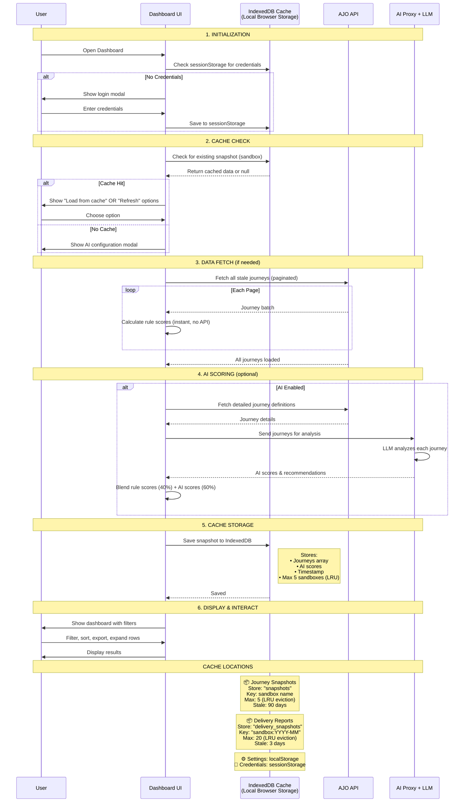

# Journey Cleanup Dashboard - High-Level Flow

## Key Flow Summary:

1. **Check Cache First** → If recent data exists (< 90 days), offer to load instantly
2. **Fetch from AJO** → Only if cache miss or user requests refresh
3. **Rule Scoring** → Happens instantly (no API calls)
4. **AI Scoring** → Optional, requires AI proxy + LLM (slower)
5. **Save to Cache** → Store in IndexedDB for future use
6. **Display Results** → Interactive dashboard with filters

## Cache Strategy:
- **Journey Analysis**: Cached per sandbox (max 5), LRU eviction, 90-day expiry
- **Delivery Reports**: Cached per sandbox+month (max 20), LRU eviction, 3-day expiry
- **Instant Load**: No API calls when loading from cache
- **Credentials**: Session-only storage (cleared on browser close)

## How to View:
1. **VS Code**: Press `Ctrl+Shift+V` (or `Cmd+Shift+V` on Mac) to preview
2. **Online**: Visit https://mermaid.live and paste the mermaid code
3. **Extension**: Install "Mermaid Preview" extension for VS Code
